# CODM Carnage 2.0 — Rift Ops

Tournament site for **Yugaantar 2026 · CODM Carnage 2.0: Rift Ops**, a Call of Duty: Mobile squad tournament: online BO1 group stage (17–21 Nov 2026), then an offline bracket at the Yugaantar Gaming Arena (27–29 Nov).

It runs the whole event in one place:
- **Public pages:** schedule, live standings and bracket for everyone.
- **Player dashboards:** room IDs, check-in and the map veto for each team.
- **Referee panel:** check-in, veto, lobby and scores. Standings, seeds and the bracket update by themselves from the scores.

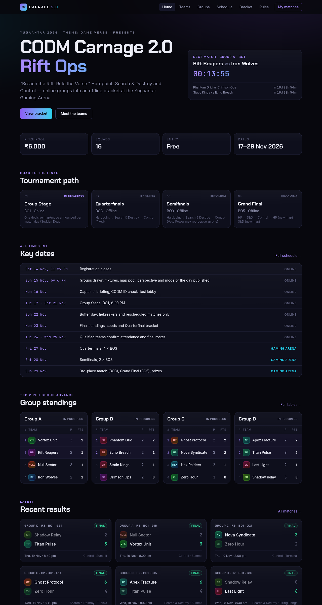

## Contents

- [Branches](#branches)
- [What's on the site](#whats-on-the-site)
  - [Public pages](#public-pages)
  - [Player dashboard](#player-dashboard)
  - [Referee and admin panel](#referee-and-admin-panel)
- [Tournament format](#tournament-format)
- [How data flows](#how-data-flows)
- [Running the event](#running-the-event)
- [Local development](#local-development)
- [Tests](#tests)
- [Production setup](#production-setup)
- [CSV import formats](#csv-import-formats)
- [Project layout](#project-layout)

## Branches

| Branch | What it is |
|---|---|
| `main` | Static site fed by a Google Sheet. No logins: organisers type map scores into the sheet and the site catches up within a minute. |
| `backend` (this one) | Supabase (Postgres + Auth). Same public pages, plus player logins, the player dashboard and the referee/admin panel. |

Both branches compute standings, seeds and bracket slots from map results with the same engine (`src/lib/tournament.ts`), so nobody ever types a table by hand.

Rules come from [`docs/rulebook.pdf`](docs/rulebook.pdf), plus [`docs/format-and-schedule.docx`](docs/format-and-schedule.docx) for format, dates, tiebreakers and seeding. `context.md` is the running project log: decisions, open questions for organisers, changelog.

## What's on the site

### Public pages

**Schedule.** Every match grouped by day, with the day's mode, map scores and the public veto result.

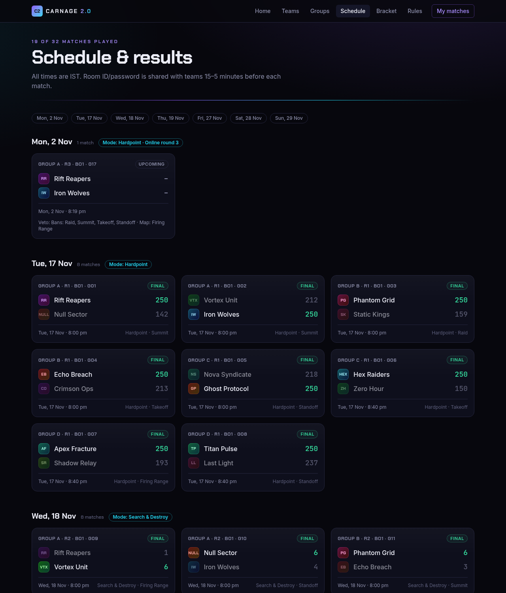

**Group standings.** Wins, head-to-head and form, with the projected overall seeding underneath. A ⚑ appears only when a finished group has a tie that affects qualifying or seeding.

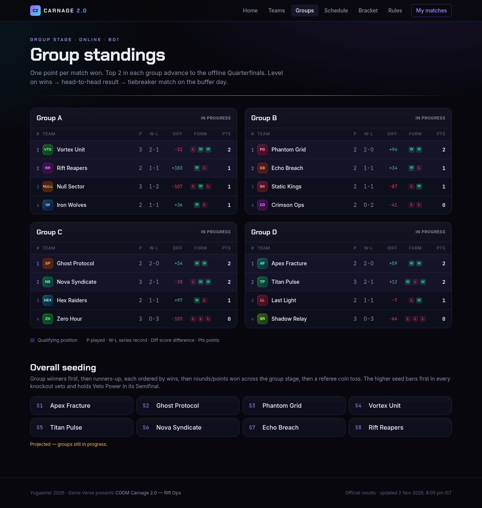

**Bracket.** The Quarterfinals fill from the seeds while groups are still running (marked PROJ), and lock in when the groups finish. Winners and losers move on as results come in.

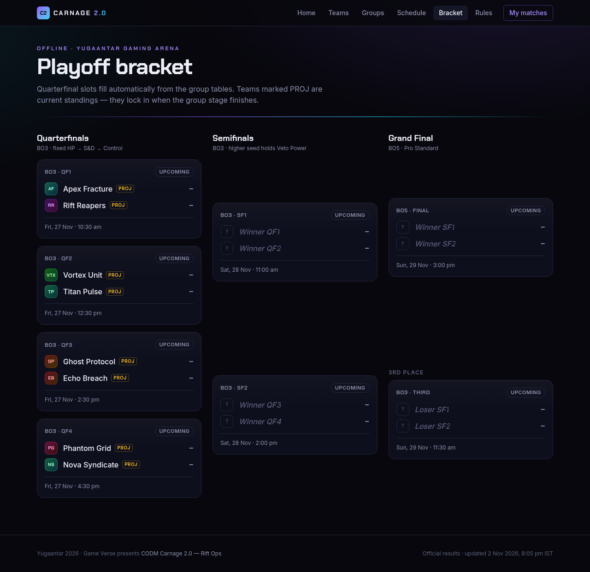

**Rules.** The rulebook in readable form. The format and schedule sections show:
- how groups are formed;
- the mode of each day;
- the evening slot times;
- the offline schedule;
- tiebreaker and seeding rules.

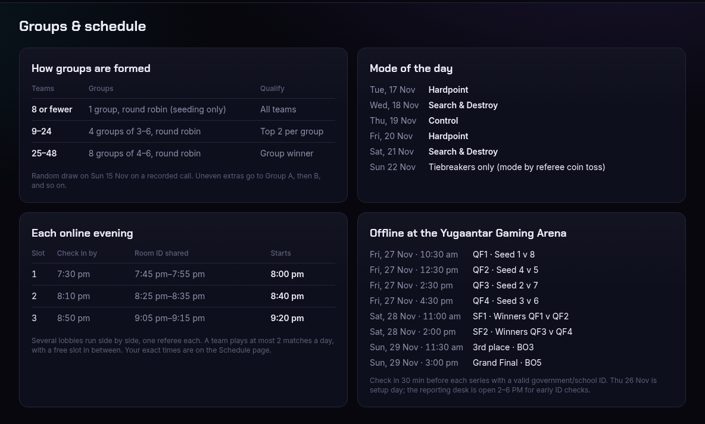

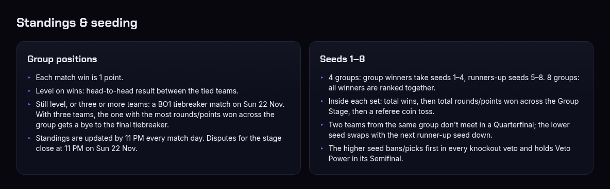

**Team pages.** Roster, results and fixtures for each squad.

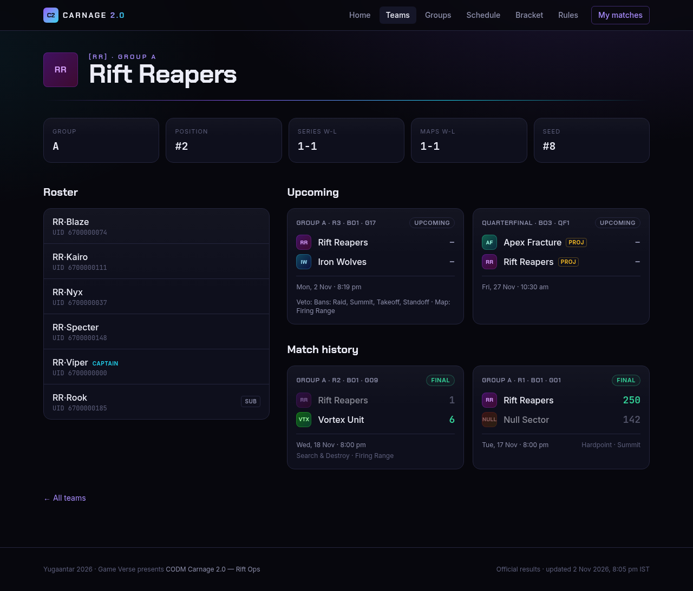

### Player dashboard

Players log in with the email their captain registered. They get a **6-digit code** by email. There's no password and no sign-up, so only imported players and staff can log in.

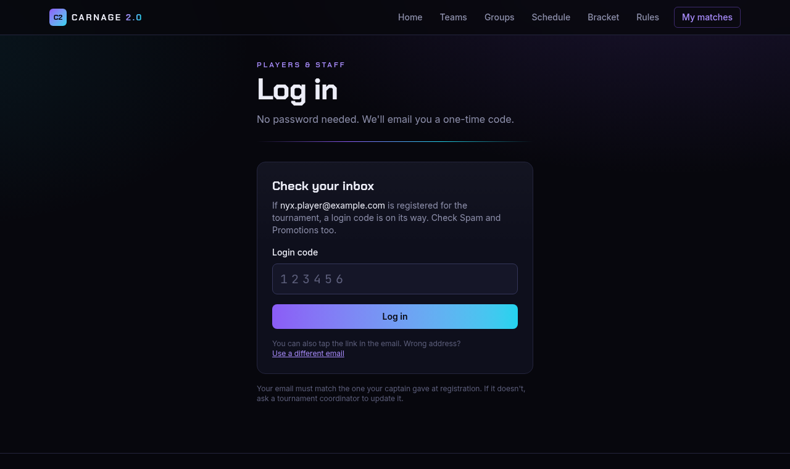

`/me` shows the player's next match with a countdown, plus:
- the mode for that day;
- check-in status, with a self check-in button from 60 min before;
- the lobby invite and its join-by time;
- the veto result;
- the room ID and password, shown only to the two teams from 15 minutes before.

It also has the team's record per mode and its match history. Captains can report substitutions and submit the Semifinal Veto Power choice.

| Desktop | Phone |
|---|---|
| 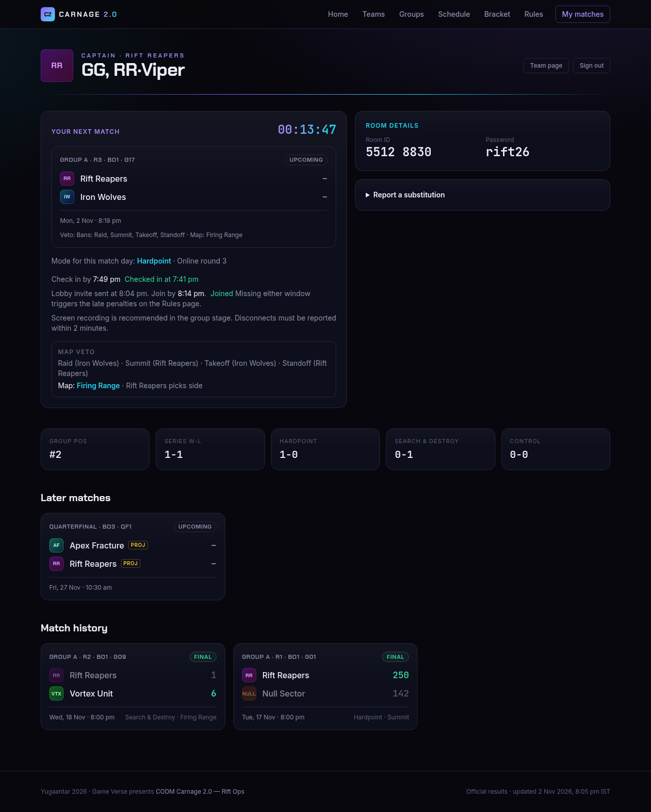 | 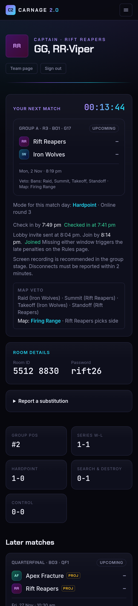 |

### Referee and admin panel

**Match list.** Every match with its status, plus counters for results awaiting approval, open disputes and live matches.

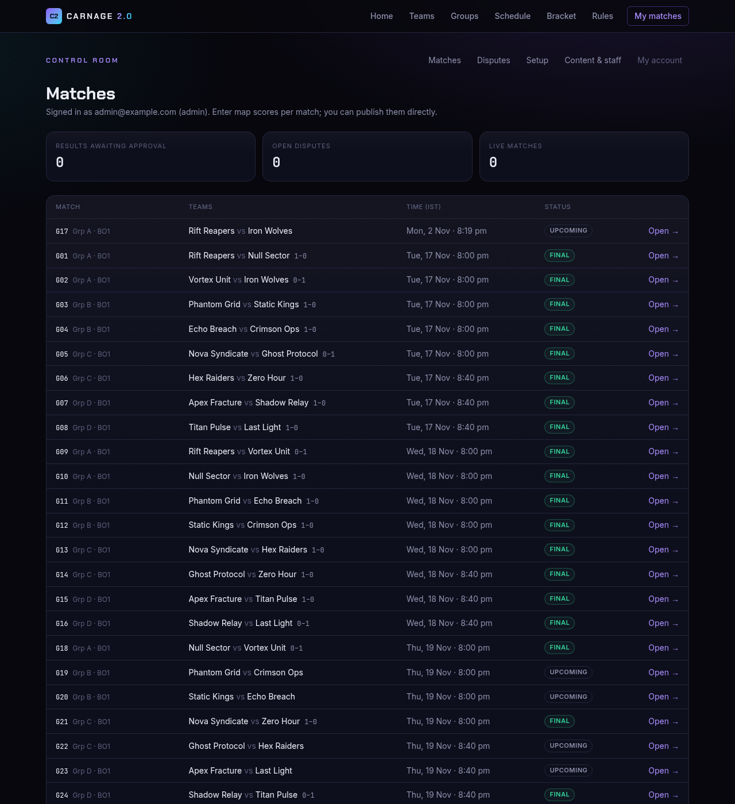

**Match page.** Everything a referee needs for one lobby:
- **Check-in & lobby:** check each team in and mark *Joined*. The page works out the late-penalty tier from whichever window a team missed by more.
- **Room details:** room ID and password, and when the in-game invite went out.
- **Map veto (BO1):** who bans first, the coin toss, and four bans. The remaining map is filled in for score entry and shown publicly.
- **Map results:** score and screenshot link. Referees save results as pending; admins publish.

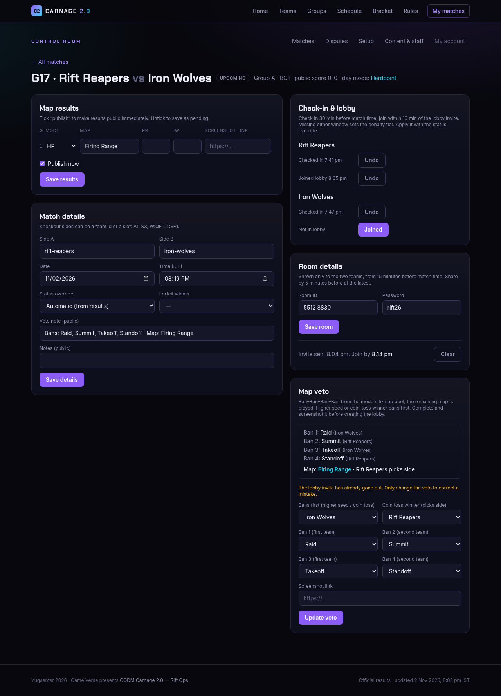

**Setup.** Runs once before the group stage, in order:
1. Import teams, then players.
2. Draw the groups.
3. Generate fixtures. The planner shows each evening's matches and finish time before anything is created.
4. Generate the knockout bracket.

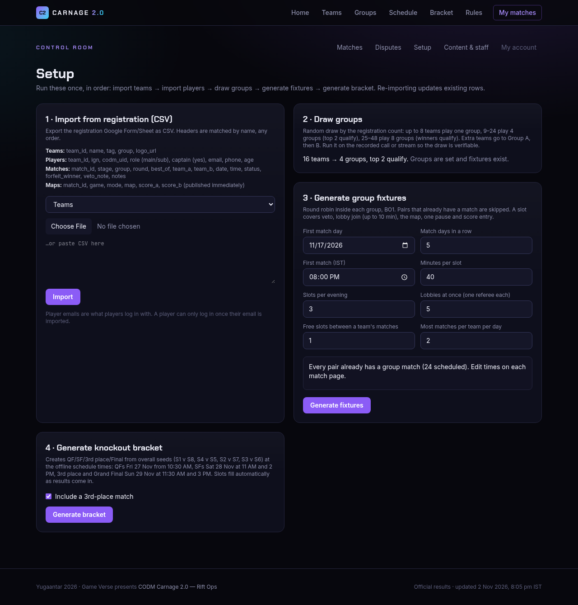

**Content & staff.**
- Settings: qualifiers, tiebreakers, coin-toss results and perspective.
- The mode of each match day.
- The map pool.
- Announcements.
- Staff accounts.

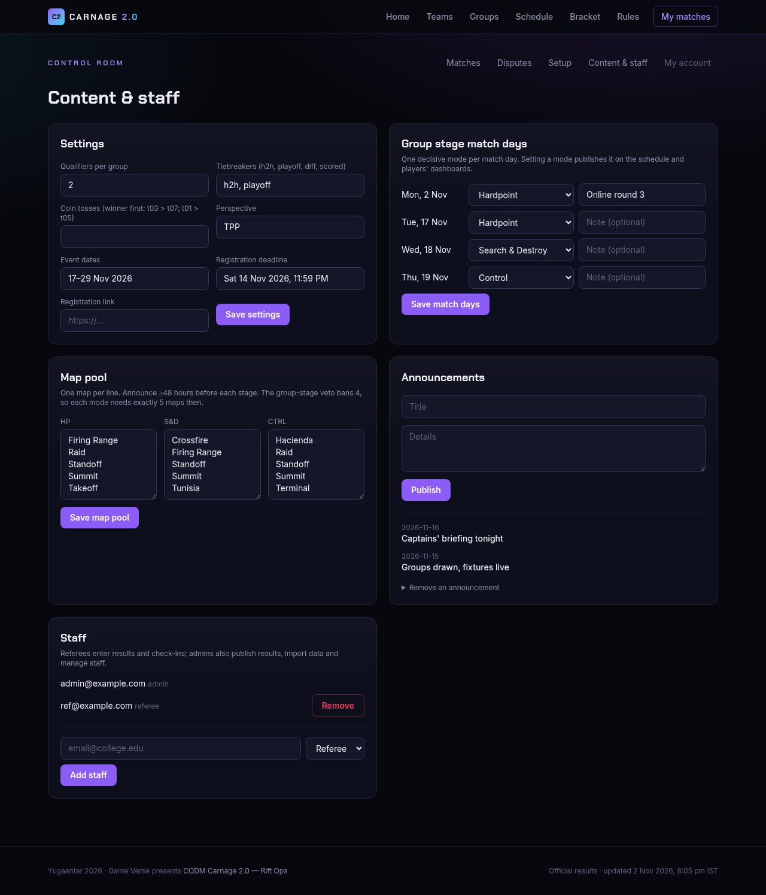

## Tournament format

From the organisers' format doc, with the online evenings fixed at **8–10 PM IST** and about **five referees**.

**Groups by registration count.** Every format sends exactly 8 teams to the offline Quarterfinals.

| Registered teams | Groups | Qualify |
|---|---|---|
| 8 or fewer | 1 group, round robin (seeding only) | All |
| 9–24 | 4 groups of 3–6 | Top 2 per group |
| 25–48 | 8 groups of 4–6 | Group winner |

**Group stage (online, BO1).** Tue 17 – Sat 21 Nov, one mode per day: HP, S&D, Control, HP, S&D. Sun 22 Nov is kept for tiebreakers and reschedules.

| Slot | Check in by | Room ID shared | Starts |
|---|---|---|---|
| 1 | 7:30 PM | 7:45–7:55 PM | 8:00 PM |
| 2 | 8:10 PM | 8:25–8:35 PM | 8:40 PM |
| 3 | 8:50 PM | 9:05–9:15 PM | 9:20 PM |

Five lobbies × three slots = 15 matches a night, 75 over the five evenings. No team plays more than 2 matches a day, and every team gets a free slot between matches.

| Teams | Groups | Matches | Evenings used |
|---|---|---|---|
| 16 | 4 × 4 | 24 | 3 |
| 24 | 4 × 6 | 60 | 5 |
| 32 | 8 × 4 | 48 | 4 |
| 38 | 8 × 4–5 | 72 | 5 (full) |
| 40+ | 8 × 5–6 | 80+ | spills into Sunday: cap registrations around 36 |

**Standings.**
1. Wins (1 point each).
2. Head-to-head between the level teams.
3. A BO1 tiebreaker match on Sun 22 Nov. In a three-way tie, the team with the most points won gets a bye to the final tiebreaker.
4. Referee coin toss.

**Seeds 1–8.**
- With 4 groups, group winners take seeds 1–4 and runners-up 5–8. With 8 groups, the winners are ranked together.
- Within each set: wins, then points won, then coin toss.
- Two teams from the same group never meet in a Quarterfinal.
- The higher seed bans first in every knockout veto and holds Veto Power in its Semifinal.

**Offline.**

| Day | Series |
|---|---|
| Fri 27 Nov | QF1 (S1 v S8) 10:30 · QF2 (S4 v S5) 12:30 · QF3 (S2 v S7) 2:30 · QF4 (S3 v S6) 4:30 (all BO3) |
| Sat 28 Nov | SF1 11:00 · SF2 2:00 (BO3) |
| Sun 29 Nov | 3rd place 11:30 (BO3) · Grand Final 3:00 PM (BO5) |

Prizes: ₹3,000 / ₹2,000 / ₹1,000.

## How data flows

```
Registration form ──CSV──► Admin → Setup: import ──► teams, players, player_contacts (email)
                                                     │
Setup: draw groups · generate fixtures · bracket ────► matches (sides are team ids or slots: A1, S3, W:QF1, L:SF1)
                                                     │
Match day: referee ► check-in · veto · room · map scores (pending) ► admin publishes (final)
                                                     │
          tournament engine: standings, seeds, bracket slots ◄── public reads see final maps only
                                                     │
          public pages (cached; every staff write refreshes them at once) + /me dashboards
```

Security:
- Row Level Security is on for every table. The public can read teams, matches and *published* map results.
- Contacts, room details, check-ins, disputes, vetoes and sub requests are staff-only in the database.
- Player actions (own team, deadlines, captain-only) are checked in server code before the service role writes them.
- Only imported players and added staff can receive a login code. The login form responds the same way for unknown emails, so nobody can probe who is registered.

## Running the event

### Before the group stage

1. **Sun 15 Nov, after registration closes:** import Teams, then Players (Admin → Setup).
2. **Draw groups** on the recorded call. The draw picks 1, 4 or 8 groups from the team count and sets qualifiers per group to match. It locks once fixtures exist.
3. **Generate fixtures.** The planner defaults to:
   - Tue 17 Nov, 5 evenings;
   - slots at 8:00, 8:40 and 9:20 PM;
   - 5 lobbies.

   Set the lobbies to the number of referees you actually have. The preview warns if anything spills past the last evening.
4. **Content:** check the mode of each match day. Keep exactly 5 maps per mode in the map pool, because the BO1 veto bans 4. Set the perspective.
5. **Generate bracket:** QF–Final plus the 3rd-place match, at the offline times.

### Each match (online)

1. **T−60 to T−30:** teams tap *Check in my team* on `/me`, or the referee checks them in from the match page.
2. **Before the lobby:** the referee records the veto: who bans first, the coin-toss winner, four bans, and a screenshot link.
3. **T−15 to T−5:** enter the room ID and password; both teams see them from T−15. Tap *Invite sent now* when the in-game invite goes out. Then mark *Joined* for each team as it arrives; teams have 10 minutes.
4. **After the map:** enter the score. An admin publishes it, and standings, seeds and the bracket update at once. Teams have 10 minutes to raise a dispute from `/me`.

### Ties

When a finished group shows a ⚑ tie:
1. Add a tiebreaker match for Sun 22 through a Matches CSV with stage `tiebreaker`. Its result orders the level teams without adding wins.
2. If a coin toss is still needed, record it under Content → Settings as `winner > loser`, e.g. `rift-reapers > null-sector`.

### Knockouts

Sides are slot references (`S1`, `W:QF1`, `L:SF1`), so they fill on their own. Referees enter each map as it finishes. A BO3 closes at 2 map wins and a BO5 at 3.

## Local development

Needs Node 22.18+ (scripts and tests run TypeScript directly) and Docker.

```bash
npm install
npx supabase start          # local Postgres + Auth + Mailpit (first run pulls images)
npx supabase status         # copy API URL / anon key / service_role key into .env.local (see .env.example)
npm run db:reset            # regenerate supabase/seed.sql from the sample data and reload the DB
npm run dev                 # http://localhost:3000
```

The sample data is 16 teams in 4 groups on the real calendar. Two rounds are played and round 3 is partly played, so the bracket shows projected slots.

Test logins (local only). Login emails land in Mailpit at http://127.0.0.1:54324.

| Email | Role |
|---|---|
| admin@example.com | admin |
| ref@example.com | referee |
| rr.viper@example.com | Rift Reapers captain |
| `<tag>.<callsign>@example.com` | any sample player, e.g. rr.nyx@example.com |

Supabase only resends a code to the same address after 60 seconds.

## Tests

```bash
npm test          # engine, rulebook timing, veto, fixtures, format rule
npm run typecheck
npm run lint
```

The unit tests cover:
- series scoring, standings, tiebreaker matches and coin tosses;
- seeding sets and the same-group Quarterfinal swap;
- late-penalty tiers, check-in and lobby windows, and the BO1 veto;
- the scheduler: lobby limits, a free slot between matches, at most 2 a day, spill detection;
- the group-count rule.

## Production setup

1. **Supabase:** create a project, then run `npx supabase link --project-ref <ref>` and `npx supabase db push`.
2. **Staff:** in the SQL editor, run `insert into staff (email, role) values ('you@college.edu', 'admin');`. Add everyone else from Admin → Content & staff.
3. **Auth → URL Configuration:** set Site URL to `https://<your-domain>`. Add `https://<your-domain>/auth/confirm` (and the Vercel preview domain) to Redirect URLs.
4. **Auth → SMTP: required.** Supabase's built-in mailer only sends to members of your Supabase organisation.
   - Use a provider such as Resend or Brevo; the free tiers are enough.
   - Send from your own domain with SPF and DKIM set up, or the emails land in spam.
5. **Auth → Email Templates:** paste `supabase/templates/login.html` into both *Magic Link* and *Confirm signup*. Use the subject "Your CODM Carnage 2.0 login code".
   - The email carries a 6-digit code plus a link to `/auth/confirm`, which logs in only when the player presses *Continue*.
   - The default template's link breaks in Gmail's in-app browser, and college mail scanners can use it up before the player clicks.
6. **Auth → Rate Limits:**
   - Raise the email limit (custom SMTP starts at 30 per hour).
   - Raise sign-ins and verifications per IP to about 150 per 5 minutes, since a venue on one Wi-Fi shares an IP.
7. **Free plan:** projects pause after 7 days without traffic. Open the site in the days before each match day.
8. **Vercel:** set the four environment variables from `.env.example`:
   - `NEXT_PUBLIC_SUPABASE_URL`
   - `NEXT_PUBLIC_SUPABASE_ANON_KEY`
   - `SUPABASE_SERVICE_ROLE_KEY`
   - `NEXT_PUBLIC_SITE_URL`
9. Follow [Before the group stage](#before-the-group-stage).

## CSV import formats

Admin → Setup → Import. Export the registration Google Form or Sheet as CSV. Headers are matched by name, in any order.

| Kind | Columns |
|---|---|
| Teams | team_id, name, tag, group, logo_url |
| Players | team_id, ign, codm_uid, role (main/sub), captain (yes), email, phone, age |
| Matches | match_id, stage (group / tiebreaker / qf / sf / third / final), group, round, best_of, team_a, team_b, date, time, status, forfeit_winner, veto_note, notes |
| Maps | match_id, game, mode, map, score_a, score_b (published immediately) |

Dates can be `YYYY-MM-DD` or `DD/MM/YYYY`, and times can be 24-hour or `6:30 PM`. All times are IST.

## Project layout

```
src/
  app/                    pages (Next.js App Router)
    page.tsx              home
    schedule/ groups/ bracket/ teams/ rules/
    login/ auth/confirm/  emailed-code login
    me/                   player dashboard and player actions
    admin/                referee/admin panel; actions.ts holds every staff write
  components/             MatchCard, GroupTable, ActionForm, …
  content/event.ts        fixed event facts: stages, key dates, slots, offline times, rule text
  lib/
    tournament.ts         engine: series, standings, tiebreakers, seeds, bracket slots
    fixtures.ts           round robin scheduler, group-count rule, draw, bracket skeleton
    rules.ts              rulebook timings: check-in, room release, late tiers, veto
    parse.ts              CSV / sheet parsing into the engine's input
    db/load.ts            Postgres → engine input
    data.ts               cached tournament read for pages, uncached for staff pages
supabase/
  migrations/             schema and Row Level Security
  seed.sql                generated from the sample data (npm run seed-sql)
  templates/login.html    login email
docs/
  rulebook.pdf  format-and-schedule.docx  screenshots/
context.md                running project log and open questions
```
