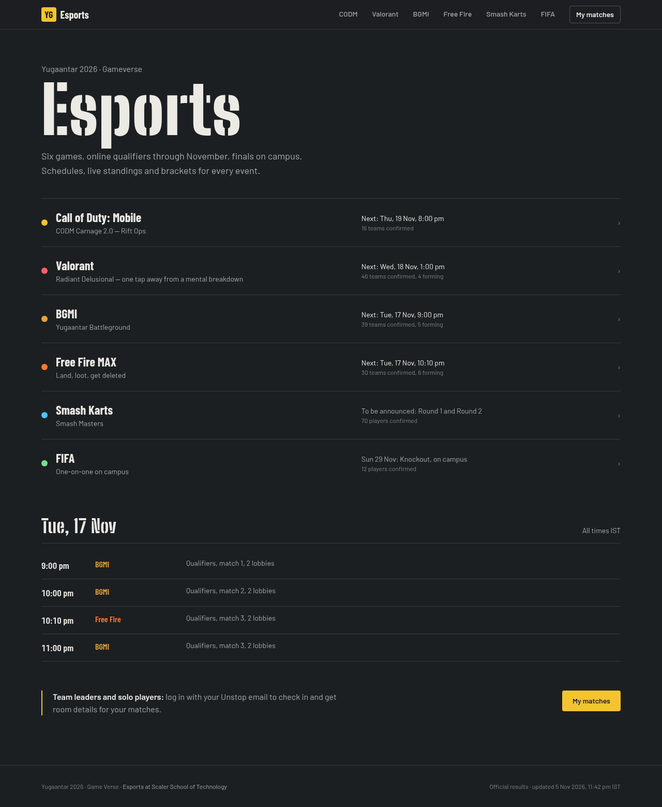
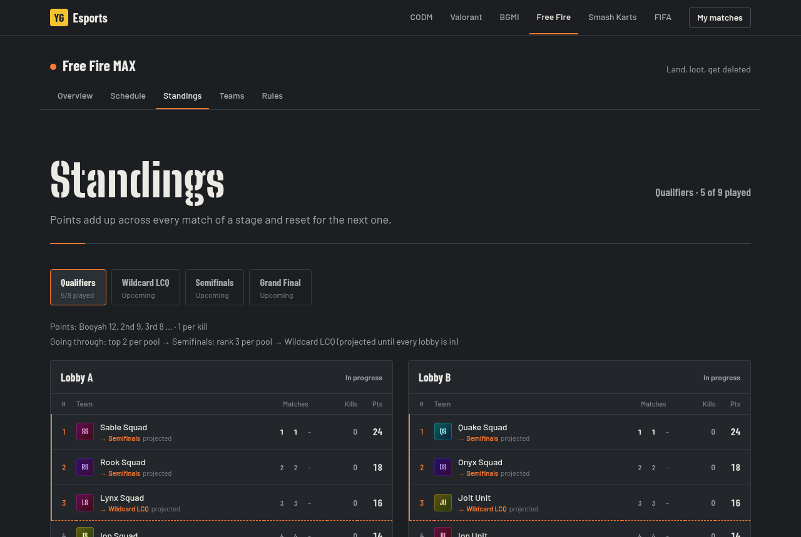
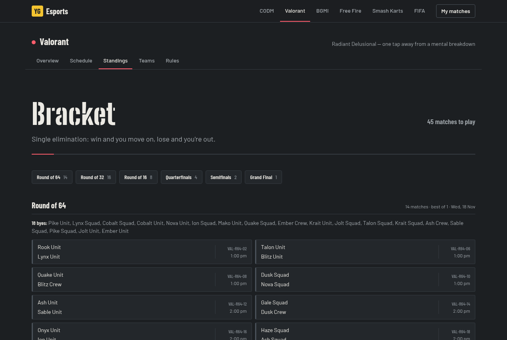
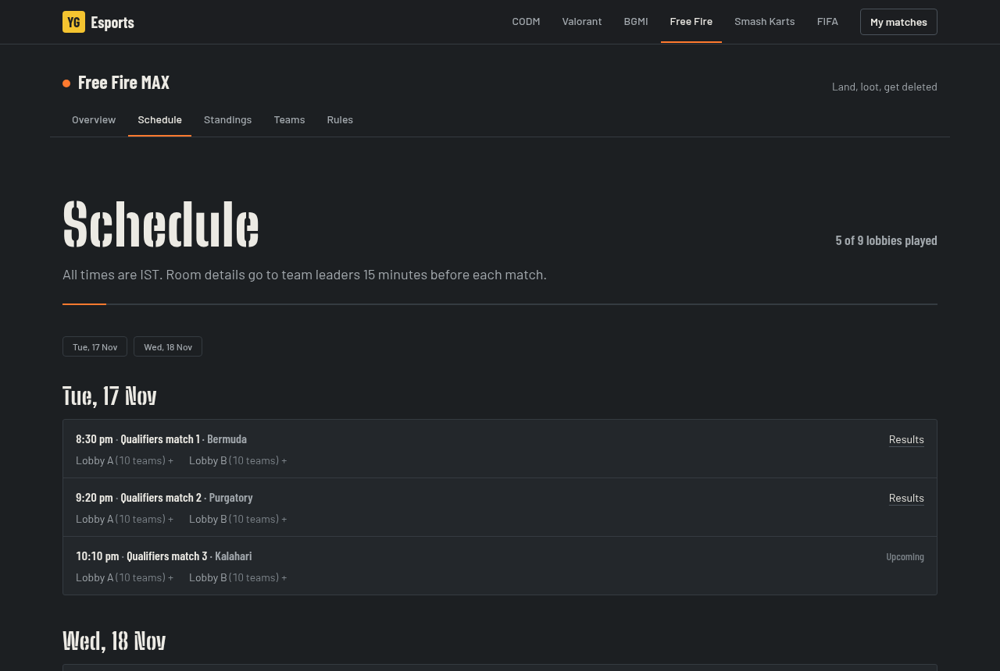

# Yugaantar 2026 Esports

The esports site for **Yugaantar 2026 · Gameverse** at Scaler School of Technology. One site runs all six events:

| Game | Entry | Format |
|---|---|---|
| Call of Duty: Mobile | squads of 5+1 | online BO1 groups, then an offline bracket (CODM Carnage 2.0: Rift Ops) |
| Valorant | teams of 5 | single elimination: BO1 online, Semifinals and Final offline |
| BGMI | squads of 4+1 | battle royale lobbies of up to 20, reshuffled every match, cumulative points |
| Free Fire MAX | squads of 4+1 | battle royale groups of up to 12, top 2 through, 3rd places to a Wildcard LCQ |
| Smash Karts | solo | free-for-all lobbies of 20, reshuffled every match, 20 → 1 points |
| FIFA | solo | knockout on campus |

This is the **`sheets` branch**: a display-only site with no database and no logins.
- **Rosters** come straight from the Unstop registrations sheet.
- **Results** come from one Google Sheet the organisers fill in during the event.
- Standings, brackets, advancement and tiebreakers are worked out by the site.



## Contents

- [Branches](#branches)
- [What's on the site](#whats-on-the-site)
- [How data flows](#how-data-flows)
- [The results sheet](#the-results-sheet)
- [Running the event](#running-the-event)
- [Game formats](#game-formats)
- [Local development](#local-development)
- [Tests](#tests)
- [Production setup](#production-setup)
- [Project layout](#project-layout)

## Branches

| Branch | What it is |
|---|---|
| `main` | The full platform: Supabase (Postgres + Auth), every game, logins, referee and admin screens. |
| `sheets` | This branch. Display only: rosters from the Unstop sheet, results from a results sheet. |
| `backend` | The CODM-only version from before the multi-game rebuild. |

The rule documents for each game are in [`docs/`](docs). The site shows a short version of each, and the PDFs are served from `public/rules/`. `context.md` is the running project log.

## What's on the site

**Hub (`/`).** Every game with its status and confirmed team count, plus the next match day across all games.

**Game pages (`/<game>`).** Each game has five tabs: Overview, Schedule, Standings, Teams and Rules. The Standings tab adapts to the format:
- **Lobby games:** one leaderboard per lobby, or one overall table when lobbies reshuffle.
  - Qualifying rows are marked with where they're going, e.g. *→ Semifinals* or *→ Wildcard LCQ*, as projected until the stage is complete.
  - Long tables (Smash Karts has ~360 players) show the top 40 and a *Find your team* box.
- **Valorant and FIFA:** the bracket, round by round. Byes are listed on one line.
- **CODM:** group tables, seeding and the offline bracket.





The **Schedule** tab groups lobbies by evening, time and match number. **Teams** lists everyone registered; each team page shows its roster (in-game names and game IDs only), results per stage and upcoming lobbies.



**Sheet status (`/status`).** Not linked from the site; for organisers. Per game: teams registered and eligible, which results tabs were found, how many matches have results, and every row the site couldn't make sense of, including team names that match no registration.

There are no logins, so **team leaders get room IDs and passwords from the organisers on the event WhatsApp and Discord groups**, as before. The hub says so.

## How data flows

```
Unstop ──► registrations sheet (one tab per game) ──┐
                                                    ├──► site (cached for 1 minute)
Organisers ──► results sheet (two tabs per game) ───┘      engines: lobby standings + advancement,
                                                           h2h standings + seeds + brackets
```

- Both sheets are read through Google's public CSV export and cached for a minute, so **an edit shows up on the site within about a minute**. Nothing needs redeploying.
- Teams are **eligible** when they're confirmed on Unstop with a full roster and one leader. Forming teams are listed with a note, e.g. *Forming, 3 of 4 players*.
- Only public fields leave the registrations sheet: team name, tag, status, in-game names, game IDs and roles. Emails, phone numbers and colleges are never shown or sent to the browser; a value that looks like an email or phone number typed into an IGN field is hidden too.
- Solo players (Smash Karts, FIFA) are shown by their in-game name.
- If the results sheet isn't set or can't be read, every game shows registrations with no results, CODM shows the sample tournament, and a banner says so.

## The results sheet

One Google spreadsheet for all games, shared as **Anyone with the link → Viewer**. Its ID (the long string in the URL, `/spreadsheets/d/<ID>/edit`) goes in `RESULTS_SHEET_ID`.

Each game has two tabs, named after the game's short name: **CODM**, **Valorant**, **FIFA**, **Free Fire**, **BGMI**, **Smash Karts**. Row 1 is the header; column order doesn't matter, names do. A missing tab just means that game has no matches yet.

`sheet-template/` has a CSV for every kind of tab with a few example rows (`npm run export-template` rewrites them). In Google Sheets: *File → Import → Upload → Insert new sheet*, then rename the tab.

**Teams are written by name**, as registered on Unstop. Case and extra spaces don't matter (`ember squad` = `Ember Squad`). Solo players can be written by in-game name, registered name or game ID. A name that matches nobody is left out of lobbies (and shown as typed in matches) and is listed on `/status`, so check it after each round of edits.

### Lobby games: `Free Fire Lobbies` + `Free Fire Results` (same for BGMI, Smash Karts)

**`<Game> Lobbies`: one row per lobby per match.**

| Column | What to write |
|---|---|
| `match_id` | Any unique id, e.g. `FF-Q-R1-A`. Results refer to it. |
| `stage` | The stage name or id from the game's format, e.g. `Qualifiers`, `Wildcard LCQ`, `lcq`, `Grand Final`. |
| `round` | Match number within the stage: 1, 2, 3 … |
| `lobby` | `A`, `B` … or `1`, `2` … In fixed-group stages (Free Fire) the lobby is the team's group. |
| `map` | Optional; defaults to the stage's map rotation. |
| `date`, `time` | `2026-11-17` (or `17/11/2026`) and `8:30 PM` (or `20:30`), IST. |
| `teams` | The teams in the lobby, separated by `;`. |
| `status` | Blank, `live` or `cancelled`. While a lobby says `live` its results stay hidden, so you can type them in and clear `live` when they're checked. |

**`<Game> Results`: one row per team per lobby.**

| Column | What to write |
|---|---|
| `match_id` | The lobby's `match_id`. |
| `team` | Team name. |
| `placement` | Finishing position, 1 = Booyah / chicken dinner / 1st. |
| `kills` | Kills (blank = 0). |
| `adjustment`, `reason` | Point penalty or bonus, e.g. `-2` and `Hit the host kart`. |

A lobby counts as played once any team in it has a placement. Points, tiebreakers and who advances come from the game's format (see [Game formats](#game-formats)).

### Head-to-head games: `Valorant Matches` + `Valorant Maps` (same for CODM, FIFA)

**`<Game> Matches`: one row per match.**

| Column | What to write |
|---|---|
| `match_id` | Unique id, e.g. `VAL-R64-01`. |
| `stage` | `group`, `tiebreak`, `r64`, `r32`, `r16`, `qf`, `sf`, `third`, `final` (or `Round of 64`, `Quarterfinal` …). |
| `group`, `round` | CODM group letter for group matches; round number for brackets. Optional. |
| `best_of` | 1, 3 or 5. Blank uses the stage's default. |
| `team_a`, `team_b` | A team name, or a slot: `W:VAL-R64-01` (winner of that match), `L:SF1` (loser), `BYE`, `A1` (CODM group A, 1st), `S3` (CODM seed 3), or blank for TBD. |
| `date`, `time` | As above. |
| `status` | Blank, `live`, `forfeit` or `cancelled`. Completed is worked out from the maps. |
| `forfeit_winner` | `A`, `B` or the winning team's name, with `status` = `forfeit`. |
| `notes` | Shown on the match card. |

**`<Game> Maps`: one row per map played.** `match_id`, `game` (map number 1, 2, 3 …), `mode` (CODM only: `HP`, `SND` or `CTRL`), `map`, `score_a`, `score_b`. A row without scores is just a planned map.

CODM teams take their group from the group matches they're in, so put the group letter on every group match. CODM can also have `CODM Config` (`qualifiers_per_group`, `tiebreakers`, `coin_toss`), `CODM Announcements` and `CODM Map Pool` tabs; templates for those are in `sheet-template/` too.

## Running the event

1. Keep both sheets shared as *Anyone with the link → Viewer*.
2. After registration closes, add each game's first-stage lobbies or first-round matches to the results sheet.
3. On match nights, room details go to leaders on WhatsApp and Discord. Mark the lobby or match `live` if you like.
4. After each lobby, type one Results row per team (or the map scores for a match), then clear `live`. The site updates within a minute.
5. When a stage ends, `/<game>/standings` shows who goes through. Add the next stage's lobbies with those teams; bracket matches written as `W:<match_id>` fill in on their own.
6. Check `/status` for unknown team names or rows that were skipped.

## Game formats

Each game's facts live in [`src/games/registry.ts`](src/games/registry.ts): roster size, sheet tab, prizes, key dates, rules summary and the stages for lobby games. Points tables, tiebreakers and advancement rules are changed there (and redeployed).

| | Lobby | Points | Tiebreakers | Advancement |
|---|---|---|---|---|
| **Free Fire MAX** | 12, fixed groups | Booyah 12, 9, 8, 7, 6, 5, 4, 3, 2, 1 + 1 per kill | Booyahs, kills, latest match | Qualifiers: top 2 per group → Semifinals, 3rd → Wildcard LCQ (top 6 through); Semifinals: top 6 per lobby → Grand Final |
| **BGMI** | 20, reshuffled | 10, 6, 5, 4, 3, 2, 1, 1, 1, 1 + 1 per kill | chicken dinners, placement points, finishes, latest match | top 32 → Semifinals → top 16 → Final |
| **Smash Karts** | 20 + host kart, reshuffled | 20 → 1 by rank | kills, best rank | top 120 → top 40 → top 20 |

The Free Fire docs disagree on some points. The defaults follow the latest one, the 17–23 Nov operations plan; the 84/104-team rulebooks use 8-7-6… instead. See *Open questions* in `context.md`.

**CODM:**
- groups by registration count, one mode per evening (8–10 PM, 3 slots × 5 lobbies);
- wins → head-to-head → tiebreaker match → coin toss;
- seeds 1–8 into an offline bracket on 27–29 Nov.

The details are on `/codm/rules`.

## Local development

Needs Node 22.18+ (scripts and tests run TypeScript directly).

```bash
npm install
cp .env.example .env.local   # set RESULTS_SHEET_ID, or leave it empty for the sample
npm run dev                  # http://localhost:3000
```

Without `RESULTS_SHEET_ID` the site shows real registrations, no results, and the CODM sample tournament.

## Tests

```bash
npm test          # engines, sheet parsing, rule timings
npm run typecheck
npm run lint
```

The tests cover:
- **Results sheet parsing:** lobbies and results by team name, unknown names, slot references and byes, and the template itself.
- **Lobby engine:** points, every tiebreaker, advancement rules (including the Free Fire LCQ) and pool-scoped ties.
- **Brackets:** any size up to 128, with byes spread out and walked over.
- **Registrations parsing:** run against the real header rows of the Unstop sheet, with invented people.
- **CODM:** standings, seeds, scheduler, veto and late-penalty timings.

## Production setup

1. Create the results sheet from `sheet-template/` and share it as *Anyone with the link → Viewer*.
2. **Vercel:** import the repo, pick the `sheets` branch, and set:
   - `RESULTS_SHEET_ID`: the results sheet's ID;
   - `REGISTRATION_SHEET_ID` and `REGISTRATION_SHEET_GIDS`: only if the Unstop sheet or its tab gids differ from the built-in defaults (`codm:<gid>,valorant:<gid>,…`);
   - `GOOGLE_SERVICE_ACCOUNT_JSON`: only if the Unstop sheet is private (share it with the service account instead).
3. Open `/status` and check every game reads its registrations and tabs.

Pages are cached and refreshed from the sheets every minute, so match-night traffic doesn't hit Google on every visit.

## Project layout

```
src/
  app/
    page.tsx                 event hub
    [game]/                  game pages: overview, schedule, standings, teams, rules
    status/                  sheet status for organisers
  games/registry.ts          every game's facts and lobby stages
  lib/
    sheets/                  results sheet: fetch, parse, roster, status, template
    sync/                    Unstop registrations: fetch and parse
    lobby/                   lobby engine: standings, tiebreakers, advancement, dealing
    knockout.ts              single-elimination brackets with byes
    tournament.ts            head-to-head engine: series, groups, seeds, slot references
    data.ts                  cached reads for the pages
  views/                     page bodies shared by the game routes (CODM, lobby, knockout)
  components/                MatchCard, StandingsTable, KnockoutBracket, …
sheet-template/              one CSV per kind of results tab
docs/                        organisers' rule documents, screenshots
```
