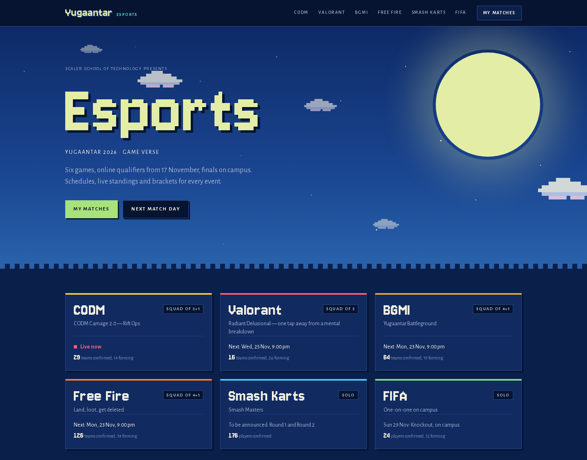
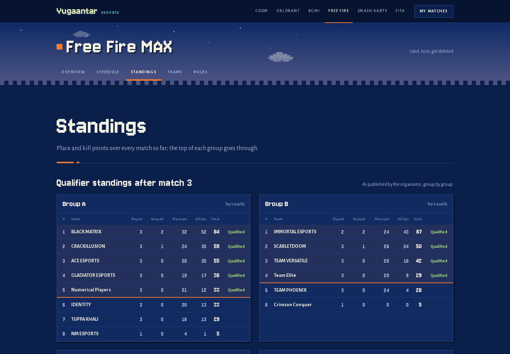
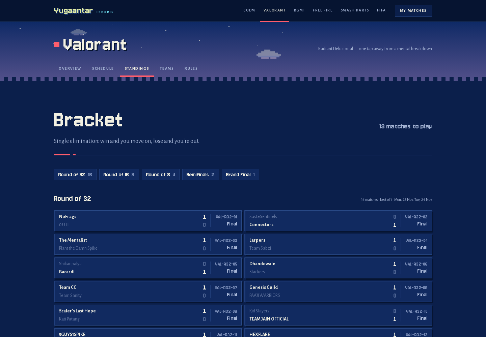
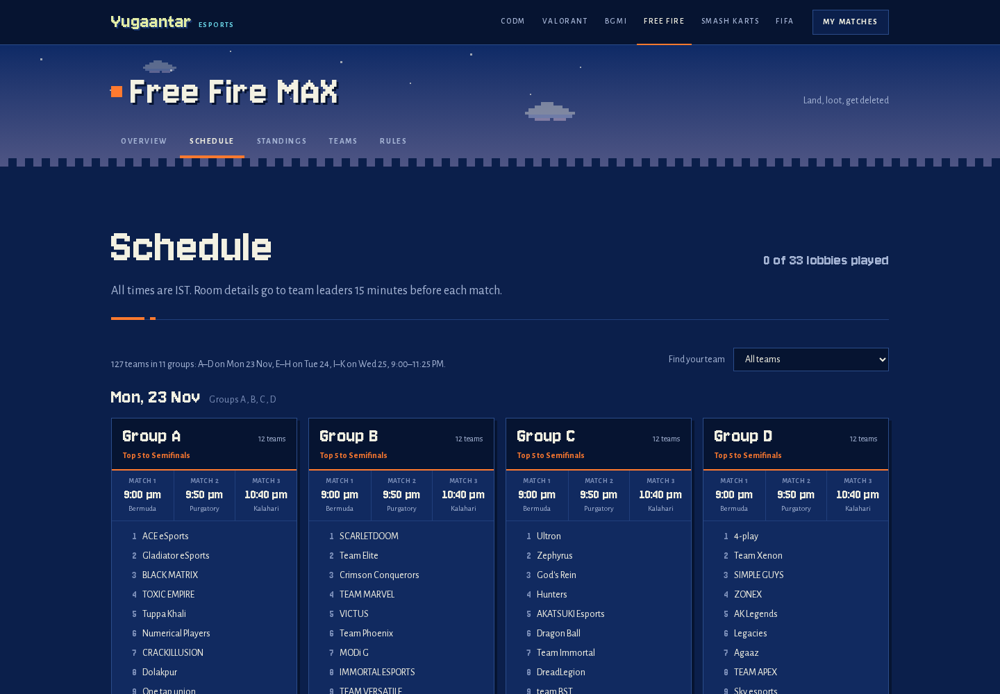
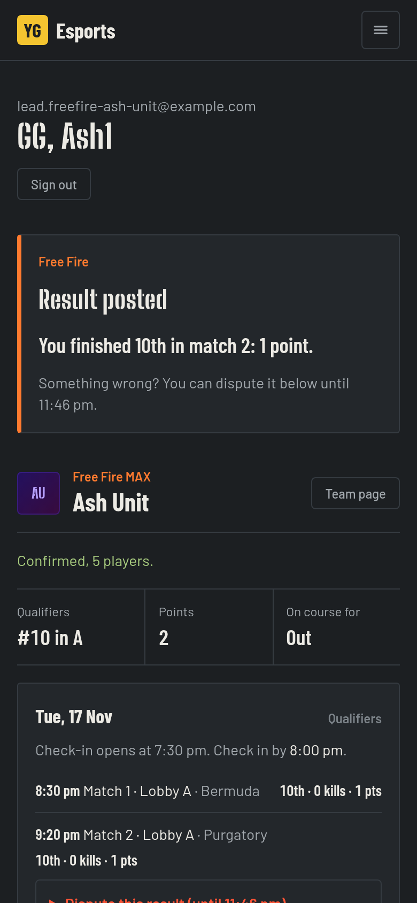
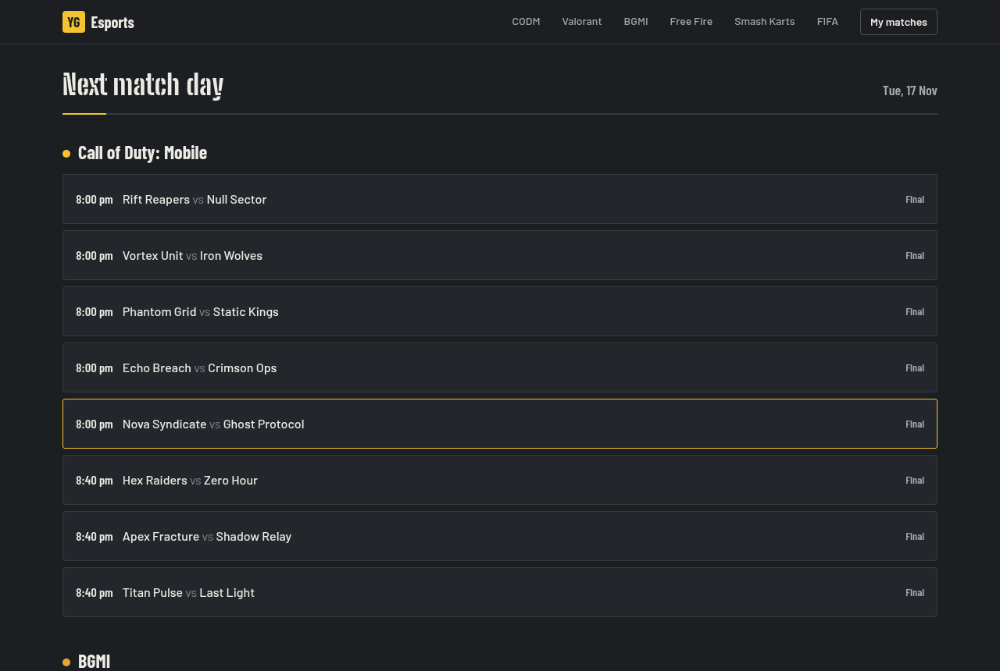
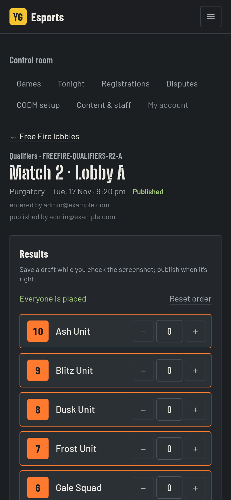
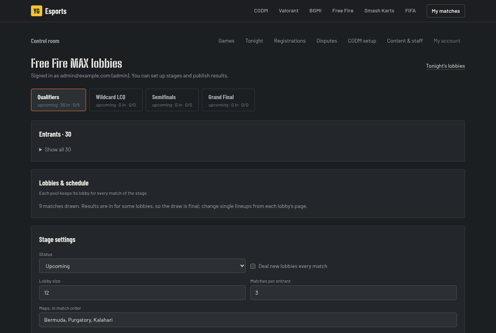
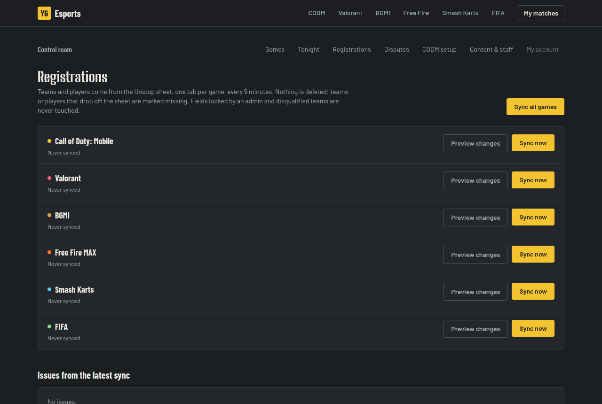

# Yugaantar 2026 Esports

The esports site for **Yugaantar 2026 · Gameverse** at Scaler School of Technology. One site runs all six events.

- **Live site:** https://yugaantar-esports.onrender.com (branch `main`)
- **Static showcase:** https://samarthpd-21.github.io/Esports/ (branch `showcase`)

| Game | Entry | Format |
|---|---|---|
| Call of Duty: Mobile | squads of 5+1 | 29 teams in 7 groups over three online mode days, online Quarterfinals, then the Semifinals and Grand Final at the arena (CODM Carnage 2.0: Rift Ops) |
| Valorant | teams of 5 | 32-team single elimination: Round of 32, 16 and 8 online (BO1, 23–25 Nov), Semifinals and Final offline |
| BGMI | squads of 4+1 | 64 teams in 4 fixed groups of 16, top 32 to the Semifinals, 16 finalists to the campus Grand Final |
| Free Fire MAX | squads of 4+1 | 127 teams in 11 fixed groups, 48 straight to the LAN Semifinals, top 12 to the Grand Final |
| Smash Karts | solo | free-for-all lobbies of 20, reshuffled every match, 20 → 1 points |
| FIFA | solo | knockout on campus |

It covers the whole event in one place:
- **Public pages:** schedules, live leaderboards and brackets for every game.
- **Registration sync:** teams and players come straight from the Unstop sheet.
- **Leader dashboards:** check-in, room details and results for team leaders and solo players.
- **Referee screens:** results are entered from a phone, and every table updates as soon as one is published.



## Contents

- [Branches](#branches)
- [What's on the site](#whats-on-the-site)
- [How data flows](#how-data-flows)
- [Running the event](#running-the-event)
- [Game formats](#game-formats)
- [Local development](#local-development)
- [Tests](#tests)
- [Production setup](#production-setup)
- [Project layout](#project-layout)

## Branches

| Branch | What it is | Deploys to |
|---|---|---|
| `main` | The live site: Supabase (Postgres + Auth), every game, leader logins, referee and admin screens. | [Render](https://yugaantar-esports.onrender.com), on every push |
| `showcase` | A static, read-only copy: no database and no logins. Teams come from the Unstop sheet at build time; fixtures and results from the published docs in `src/content/`. | [GitHub Pages](https://samarthpd-21.github.io/Esports/), on every push or *Actions → Pages → Run workflow* |

Changes to shared code (rules, content, components) go to `main` first and are cherry-picked onto `showcase`. Files that need the database (`src/app/admin`, `src/app/me`, `src/lib/db`, …) don't exist on `showcase`, so a cherry-pick that touches them drops those files.

The rule documents for each game are in [`docs/`](docs). The site shows a short version of each, and the PDFs are served from `public/rules/`. `context.md` is the running project log: decisions, open questions for organisers, changelog.

## What's on the site

### Public pages

**Hub (`/`).** Every game with its status and confirmed team count, plus the next match day across all games.

**Game pages (`/<game>`).** Each game has five tabs: Overview, Schedule, Standings, Teams and Rules. The Standings tab adapts to the format:
- **Lobby games:** one leaderboard per lobby, or one overall table when lobbies reshuffle.
  - Qualifying rows are marked with where they're going, e.g. *→ Semifinals* or *→ Grand Final*, as projected until the stage is complete.
  - Long tables (Smash Karts has ~360 players) show the top 40 and a *Find your team* box.
- **Valorant and FIFA:** the bracket, round by round. Byes are listed on one line.
- **CODM:** group tables, seeding and the knockout bracket. Its Schedule tab opens with the knockout days still to play, then finished knockouts (latest first), then the group stage as a wave board like the published fixtures image: 7 waves × 7 lobbies, each match-up's Hardpoint, Domination and S&D results side by side, and a *Find your team* picker.





The **Schedule** tab groups lobbies by evening, time and match number. **Teams** lists everyone registered; each team page shows its roster, results per stage and upcoming lobbies.



### Leader dashboard (`/me`)

Only **team leaders and solo players** log in, with the email they registered on Unstop. They get a 6-digit code by email; there's no password and no sign-up. Team members don't need an account, since everything they need is public.

At the top of the page is one **"Do this now"** card. It shows whichever matters most right now:
- check in for tonight;
- the room ID and password, with copy buttons;
- a result that was just posted;
- the countdown to the next match.

Below it there's one section per team the person leads; a person can lead teams in several games. Each section shows:
- eligibility, e.g. *Forming, 3 of 4 players*;
- the team's lobbies or matches, evening by evening;
- one check-in per evening for lobby games;
- published placements, kills and points;
- a dispute button while the window is open.

CODM keeps its own dashboard: veto, substitutions and Veto Power.



### Referee screens

**The control room (`/admin`)** is one place for admins and referees, with one menu down the side (a scrolling row on phones):
- **Overview:** a card per game with what needs attention (results to publish, open disputes) and the next match day's lobbies and matches, each opening its staff page.
- **One entry per game.** Admins see all six; a referee sees only the games on their tags, and any other game's pages refuse them (so does the database).
- **Across games:** Disputes (every game's, open first), Registrations, and for admins Announcements and Staff. *Your details* holds a staff member's contact info.

**Staff (`/admin/staff`)** gives accounts roles by email: `admin`, or game tags such as `codm-ref`, `valo-ref`, `bgmi-ref`, `ff-ref`, `karts-ref` and `fifa-ref` (or all games). Admins run everything. A referee runs their own games end to end (stages, draws, brackets, publishing results, that game's registration sync) and can't touch any other game; the database enforces this too, down to who can read player contact details.

**Your own schedule:** a logged-in team leader sees their team's next matches pinned to the top of that game's Overview and Schedule, and can add them to their phone calendar. The feed (`/calendar/<game>/<team>.ics`) updates as matches are drawn or moved and reminds them when check-in opens.

**Referees on game pages:** every game's Overview lists its referees and organisers. Names are public; WhatsApp, Discord and email only show to that game's team leaders (also on their dashboard) and staff. Staff fill in their own details on the control room home; admins can edit anyone's on the Staff page.



**Lobby result entry** is built for a phone:
1. Tap teams in finishing order, and tap again to undo.
2. Set kills with a stepper.
3. Add point adjustments with a reason (e.g. −2 for hitting the Smash Karts host kart) and paste the screenshot link.
4. *Save draft*, then *Publish*. Publishing needs every placement filled in and unique.

The same page sets the room details, marks the lobby live or cancelled, shows who checked in, edits the lineup and resolves disputes. If two referees save the same lobby, the second is told to reload instead of overwriting.



**Head-to-head matches** (CODM, Valorant, FIFA) use the match page: check-in, room, map scores, and the CODM map veto.

### Admin

Each game's page has the same header and tabs:
- **Lobby games (Free Fire, BGMI, Smash Karts):** *Lobbies* is match night (every lobby's result state, then the standings); *Setup* holds the official groups, entrants, draw and schedule, and stage settings.
- **CODM:** *Matches* (filter by day and lobby), *Setup* (official groups and fixtures, mode day times, bracket) and *Settings* (qualifying, map pool).
- **Valorant and FIFA:** *Matches*, with the bracket draw until it's made.

On Setup, a lobby game's control room:
- creates the stages from the game's doc;
- fills entrants from eligible teams, or from the previous stage's qualifiers;
- draws lobbies and schedules them, with the doc's times filled in;
- edits points tables, tiebreakers and advancement rules;
- lists every lobby with its result state.

For Valorant and FIFA it draws the bracket, seeded or random. Valorant's published bracket (32 teams, R32 on 23–24 Nov, R16 on 24–25 Nov, R8 on 25 Nov) is set up from Overview with the other games' fixtures.



**Registrations (`/admin/sync`)** shows each game's last sync, eligible teams, *Preview changes* and *Sync now*, and the problems to fix on Unstop.



## How data flows

```
Unstop ──► registrations sheet (one tab per game)
              │  every 5 min (Supabase cron → /api/sync) or "Sync now"
              ▼
         teams, players, player_contacts  (eligible = confirmed + full roster + one leader)
              │
 Admin: stages, lobbies, bracket ──► lobby_matches (lineups public) / matches
              │
 Referee: placements + kills (draft) ──► publish ──► lobby_results / maps
              │
 Engines: lobby standings + advancement, h2h standings + seeds + brackets
              │
 Public pages (cached per game; a publish refreshes that game at once) + /me dashboards
```

**The sync** matches teams by name and players by email.
- Nothing is ever deleted: rows that disappear from the sheet are marked missing.
- Withdrawn duplicates that Unstop leaves behind are ignored.
- A renamed team is recognised by its leader's email.
- Fields an admin locked, and disqualified teams, are never touched.
- After a game's roster lock time, changes are listed for an admin instead of applied.

**Security**
- Row Level Security is on for every table. The public reads teams, schedules, lineups and *published* results.
- Contacts, room details, check-ins, disputes and drafts are staff-only in the database.
- Leader actions are checked in server code (own team, leader only, inside the time window) before the service role writes them.
- The login form responds the same way to unknown emails.

## Running the event

### Before the first match

1. Share the registrations sheet with the service account, or keep it public, and check **Registrations** shows every game syncing.
2. Fix what the issues list flags on Unstop: duplicate emails, missing IGNs or game IDs, rosters that are too small.
3. After registration closes:
   - **Free Fire, BGMI:** open the game's control room → *Create stages* → on the Qualifiers stage, *Apply groups and schedule*. That puts every registered team in its published group (pick any name that doesn't match) and creates every match at the published time.
   - **Smash Karts:** *Create stages* → *Fill from eligible teams* → *Draw lobbies*.
   - **Valorant, FIFA:** *Draw bracket*.
   - **CODM:** CODM → Setup → *Apply groups and fixtures* (the official 29 teams and 138 matches; pick any name that doesn't match a registration) → set each mode day's first wave. The knockout matches are in a migration, since the Quarterfinals were a published random draw rather than by seed.
4. Add referees under Staff and tag each with their games (e.g. `valo-ref`).

### A lobby night (Free Fire, BGMI, Smash Karts)

1. Leaders check in from `/me`, once for the whole evening.
2. The referee opens the lobby from `/ref`, enters the room ID and password, and marks the lobby live. Leaders see the room details from the game's reveal time (15 minutes before for most games).
3. After the match the referee taps in the finishing order and kills, pastes the screenshot link and publishes. An admin publishes instead if referees aren't allowed to.
4. When every lobby of a stage is published, the next stage's *Fill from …* takes the qualifiers.

### A head-to-head match (CODM, Valorant, FIFA)

Check-in, room and scores happen on the match page. Brackets move on their own: sides are references like `W:VAL-R64-01`, and byes are walked over automatically.

## Game formats

Each game's facts live in [`src/games/registry.ts`](src/games/registry.ts): roster size, sheet tab, check-in and room times, prizes, key dates, rules summary and the stages for lobby games. Points tables, tiebreakers and advancement rules can be changed per stage in the admin panel.

| | Lobby | Points | Tiebreakers | Advancement |
|---|---|---|---|---|
| **Free Fire MAX** | 12, fixed groups | Booyah 12, 9, 8, 7, 6, 5, 4, 3, 2, 1 + 1 per kill | Booyahs, kills, latest match | Qualifiers (A–D Mon, E–H Tue, I–K Wed): top 5 per group in A–D, top 4 in E–K → 48 LAN Semifinalists; Semifinals: 4 groups of 12, top 3 per group → 12-team, 6-match Grand Final |
| **BGMI** | 16, fixed groups | 10, 6, 5, 4, 3, 2, 1, 1, 1, 1 + 1 per kill | chicken dinners, placement points, kill points, latest match | Qualifiers (A–B Mon, C–D Tue): top 32 overall → Semifinals (Wed 25) → 16 finalists → Grand Final (Sat 28 Nov, 12–4 PM, campus, 1 lobby, 4 matches). Prizes ₹5,000 / ₹3,000 / ₹2,000 |
| **Smash Karts** | 20 + host kart, reshuffled | 20 → 1 by rank | kills, best rank | top 120 → top 40 → top 20 |

Free Fire follows the 23–25 Nov Pre-Round Schedule and its group allocations; the older 84/104-team rulebooks (8-7-6… points, a Wildcard LCQ) are superseded. BGMI follows the 23 Nov progression and group allocations. All of these are in `docs/`, and the published groups are `src/content/lobby-groups.ts`. Group standings the organisers published as totals, and BGMI's 16 finalists, are in `src/content/official-standings.ts`.

**CODM** follows the Master Tournament Doc (Final) in `docs/`:
- 29 teams in 7 groups (six of 4, Group G of 5). Every pair plays once per mode, one mode a day: Hardpoint on Summit (Mon 23 Nov), Domination on Raid (Tue 24), S&D on Tunisia (Wed 25). 46 BO1 matches a day across 7 waves × 7 lobbies; a team's wave and lobby stay the same all three days. The schedule is `src/content/codm-schedule.ts`.
- 1 point per win. Level teams: wins against each other, then a tiebreaker match. Score difference never counts.
- The 7 group winners and the best runner-up go through. The Quarterfinals were a random draw (EDGE v J²•D•Y•S, RVCE v Bawts, LIQUID v Freakuency, TF141 v $500), played online at 10 PM on Fri 27 Nov as BO3s, HP → S&D → Control, from a 3-map pool per mode. Only the winners were published, so those series are marked *won, no map scores*.
- Sat 28 Nov has no matches. Sun 29 Nov at the Gaming Arena from 11 AM: Semifinals (BO3), 3rd-place match (BO3) and Grand Final (BO5).
- The draw, maps and winners are in `src/content/event.ts`; the live site has the same in `supabase/migrations/20261128*`.
- Online, captains check in once a day, 30 minutes before the first wave.

The details are on `/codm/rules`.

## Local development

Needs Node 22.18+ (scripts and tests run TypeScript directly) and Docker.

```bash
npm install
npx supabase start          # local Postgres + Auth + Mailpit
npx supabase status         # copy the API URL and keys into .env.local (see .env.example)
npm run db:reset            # rebuild supabase/seed.sql and reload the database
npm run dev                 # http://localhost:3000
```

The seed has the CODM tournament on the 29 official teams (Hardpoint day played, Domination half done) plus invented registrations for every other game, some of them still forming. Login emails land in Mailpit at http://127.0.0.1:54324.

| Email | Role |
|---|---|
| admin@example.com | admin |
| ref@example.com | referee, every game |
| ff.ref@example.com | referee, Free Fire only |
| liqu.viper@example.com | CODM captain (LIQUID) |
| `lead.<team-id>@example.com` | leader of any other seeded team, e.g. lead.freefire-ash-unit@example.com |

To try the sync locally, set `SYNC_SECRET` in `.env.local` and call `curl -H "Authorization: Bearer $SYNC_SECRET" "localhost:3000/api/sync?dry=1"`. Leave out `dry=1` to write.

## Tests

```bash
npm test          # engines, sync parsing, rule timings
npm run typecheck
npm run lint
```

The tests cover:
- **Lobby engine:** points, every tiebreaker, advancement rules (including per-group cutoffs like Free Fire's 5 from A–D, 4 from E–K), pool-scoped ties, and the published Free Fire and BGMI groups and times.
- **Lobby dealing:** reshuffles that avoid repeat opponents, scheduling, and checks on entered results.
- **Brackets:** any size up to 128, with byes spread out and walked over.
- **Sync parsing:** run against the real header rows of the Unstop sheet, with invented people.
- **CODM:** the published schedule (every pair once per mode, no team twice in a wave, the doc's times), standings, the best runner-up, seeds, vetoes, day check-in and late penalties.

## Production setup

1. **Supabase:** create a project in Mumbai (ap-south-1), then run `npx supabase link --project-ref <ref>` and `npx supabase db push`.
2. **First admin:** in the SQL editor, run `insert into staff (email, role) values ('you@college.edu', 'admin');`. Add everyone else from Admin → Content & staff.
3. **Auth → URL Configuration:** set the Site URL to `https://<your-domain>`, and add `https://<your-domain>/auth/confirm` to Redirect URLs.
4. **Auth → SMTP (required):** the built-in mailer only reaches your own Supabase organisation.
   - Brevo (300 a day free), Amazon SES or a Gmail app password all work.
   - Leaders log in about once for the whole event, so a few hundred emails cover it.
5. **Auth → Email Templates:** paste `supabase/templates/login.html` into *Magic Link* and *Confirm signup*. Use the subject "Your Yugaantar Esports login code".
6. **Auth → Rate Limits:** raise the email limit, and raise sign-ins per IP to about 150 per 5 minutes (a venue shares one Wi-Fi IP).
7. **Render (the website):** in the Render dashboard choose *New → Blueprint* and pick this repo. [`render.yaml`](render.yaml) sets up one Node web service in Singapore on the Starter plan (the free plan sleeps when idle).
   - Paste `NEXT_PUBLIC_SUPABASE_ANON_KEY` and `SUPABASE_SERVICE_ROLE_KEY` from Supabase → Project Settings → API keys. The Supabase URL is already filled in, and `SYNC_SECRET` is generated.
   - If the service gets a different address, or you add a custom domain, update `NEXT_PUBLIC_SITE_URL` and redeploy.
   - Add `GOOGLE_SERVICE_ACCOUNT_JSON` if the Unstop sheet is private, and `REGISTRATION_SHEET_ID` if it isn't the default sheet.
   - Every push to `main` deploys.
8. **Sync every 5 minutes:** run [`supabase/snippets/sync-cron.sql`](supabase/snippets/sync-cron.sql) once in the SQL editor, with your site URL and secret.
9. **Free plan:** projects pause after 7 days without traffic, which the sync job prevents.

Public pages are cached per game and refreshed whenever a result is published, so match-night traffic barely touches the database.

## Project layout

```
src/
  app/
    page.tsx                 event hub
    [game]/                  game pages: overview, schedule, standings, teams, rules
    me/                      leader dashboard and leader actions
    ref/                     referee home: tonight's lobbies and matches
    admin/                   games, per-game control rooms, lobby result entry, sync, CODM setup
    api/sync/                registration sync endpoint (cron)
  games/registry.ts          every game's facts and lobby stage defaults
  content/                   published fixtures, groups, standings and CODM event facts
  lib/
    lobby/                   lobby engine: standings, tiebreakers, advancement, dealing; data loader
    sync/                    Unstop sheet: fetch, parse, apply
    knockout.ts              single-elimination brackets with byes
    tournament.ts            head-to-head engine: series, groups, seeds, slot references
    data.ts                  cached reads for public pages
  views/                     page bodies shared by the game routes (CODM, lobby, knockout)
  components/                MatchCard, StandingsTable, KnockoutBracket, …
supabase/
  migrations/                schema and Row Level Security
  snippets/sync-cron.sql     scheduled sync
  seed.sql                   generated local data (npm run seed-sql)
docs/                        organisers' rule documents, screenshots
```
